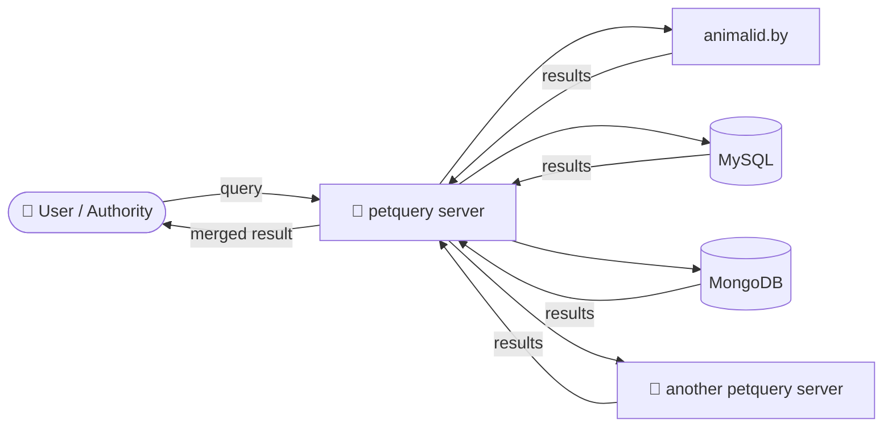

<div align="center">

# 🐾 petquery

**One search. Every registry. Bring lost pets home — across borders.**

[](https://github.com/ykat-UG-haftungsbeschrankt/petquery/releases)


[Website](https://petquery.org) ·
[Repository](https://github.com/ykat-UG-haftungsbeschrankt/petquery) ·
[API docs](#-documentation)

</div>

---

## 💡 Why petquery?

When a pet goes missing, most national authorities only search the national
and local registries that hold owner information. A pet that travelled with
its owner, or wandered over a border, can end up in a database nobody thinks
to check.

**petquery** is a small, plugin-based **meta search engine** for pet
microchip IDs. You enter one query, it asks every configured registry at the
same time, and it returns a single combined result.

## ✨ Features

- 🔌 **Plugin-based**: every data source is a plugin. Use the built-in ones or
  write your own in a few lines.
- ⚡ **Parallel queries**: all plugins are queried at the same time. One slow
  or failing source never blocks the others.
- 🌍 **Federated**: petquery servers can query *each other*, so authorities
  can share their local data without sharing their database.
- 🔁 **Loop-safe**: each server has its own UUID, and queries carry a
  traceroute of the servers they have passed through, so loops between
  federated servers can be spotted.
- 🛡️ **Validated I/O**: incoming and remote JSON is checked with
  [`cast.ts`](https://www.npmjs.com/package/cast.ts) before it is used.
- 🔐 **Bearer authentication** for the machine-facing endpoints.
- 📎 **File uploads**: photos or documents can be attached to a query and are
  passed on to the plugins.

## 🧭 How it works



## 🚀 Quick start

```bash
git clone https://github.com/ykat-UG-haftungsbeschrankt/petquery.git
cd petquery
npm install
npm start
```

`npm start` lints and compiles the TypeScript sources to native ES modules in
`dist/`, then starts the server on <http://127.0.0.1:50000/>.

> [!TIP]
> In VS Code, use the **Launch PetQuery** debug configuration. It builds the
> project, starts the server and opens it in your browser.

## ⚙️ Configuration

All settings are in
[`src/pet/query/config.ts`](src/pet/query/config.ts):

| Setting | What it does |
|---|---|
| `server.http` / `server.https` | Ports, on/off switches and the TLS certificate |
| `server.authenticate.bearer` | The bearer tokens accepted by `/json` and `/api` |
| `server.index.database` | Server index and saved configuration storage |
| `server.file.upload` | Upload switch and `max_file_size` (10 MB) |
| `server.max_results_per_module` | Maximum number of results kept per plugin |
| `server.max_results_total` | Maximum number of results in a response |
| `server.index` | Database instance and peer sync of the server index |
| `server.settings.database` | Database instance for local pet records |
| `server.route` | Turns each endpoint on or off and sets its authentication |
| `plugin` | One entry per plugin: on/off, timeout, source and settings |

At startup, values saved by the [admin GUI](#admin-gui) in the configured
database override these defaults. Configuration and the server UUID share the
database's settings store; bearer tokens never need to be stored in a source
file.

> [!IMPORTANT]
> Replace the example bearer tokens with your own secrets before you deploy.

## 🌐 Endpoints

| Endpoint | Auth | Returns | Turned on by |
|---|:---:|---|---|
| `/` | — | Redirects to `/gui` | — |
| `/gui/*` | —/🔐 | PetQuery GUI and Admin sections | `route.gui.enabled` |
| `/json` | — | Merged results from all plugins and local pets | `route.json.enabled` |
| `/api` | 🔐 user/admin | Results from the configured API plugins | `route.api.enabled` |
| `/api/server/*` | varies | Read or manage the server index | `route.api.enabled` |
| `/api/config/*` | 🔐 admin | Read or save the editable config | `route.api.enabled` |
| `/api/pets` | 🔐 user/admin | Manage local pet JSON records | `route.api.enabled` |
| `/auth/*` | varies | Login, sessions and user management | — |
| `/docs/` | — | Generated API documentation | — |

Every search endpoint accepts `GET` query strings, JSON or form `POST`
bodies, and `multipart/form-data` file uploads.

| Parameter | Type | Description |
|---|---|---|
| `query` | `string` | The pet ID to look up, e.g. a microchip number |
| `tracerouteUuid` | `uuid[]` | Servers the query has passed through (federation) |

### API schemas

Successful API responses use this envelope:

```json
{
	"success": true,
	"error": [],
	"data": {}
}
```

Validated request and response schemas are generated from the TypeScript
definitions. The complete schema index is:

| Endpoint | Request schema | Response schema |
|---|---|---|
| `GET /api/ping/get` | [`request.json`](schema/api/ping/get/request.json) | [`response.json`](schema/api/ping/get/response.json) |
| `GET /api/server/get` | [`request.json`](schema/api/server/get/request.json) | [`response.json`](schema/api/server/get/response.json) |
| `PUT /api/server/put/:uuid` | [`request.json`](schema/api/server/put/request.json) | [`response.json`](schema/api/server/put/response.json) |
| `DELETE /api/server/delete/:uuid` | [`request.json`](schema/api/server/delete/request.json) | [`response.json`](schema/api/server/delete/response.json) |
| `GET /api/config/get` | [`request.json`](schema/api/config/get/request.json) | [`response.json`](schema/api/config/get/response.json) |
| `PUT /api/config/put` | [`request.json`](schema/api/config/put/request.json) | [`response.json`](schema/api/config/put/response.json) |
| `POST /json` | [`request.json`](schema/search/request.json) | [`response.json`](schema/search/response.json) |
| `POST /api` | [`request.json`](schema/search/request.json) | [`response.json`](schema/search/response.json) |

The request-schema envelope mirrors the Express request parts:

```json
{
	"params": {},
	"query": {},
	"body": {}
}
```

For `POST /json` and `POST /api`, `body.query` is the search string.
`body.tracerouteUuid` is an optional UUID array with at most 1000 entries.
Query-string values are strings, so `query.iframe` accepts `"true"` or
`"false"`, while JSON and form bodies accept a boolean.

All generated schemas are also available as TypeScript sources under
[`schema/`](schema) and can be regenerated with `npm run build:schema`.

### `/json`: search everything

Use this to show petquery results on your own website or in your own
application.

<details open>
<summary><b>JavaScript</b></summary>

```js
const response = await fetch('https://petquery.org/json', {
	method: 'POST',
	headers: {
		'accept': 'application/json',
		'content-type': 'application/json',
		'authorization': 'Bearer <your-token>'
	},
	body: JSON.stringify({query: '112093400000465'})
});
if(!response.ok){
	throw new Error(response.statusText);
}
console.log(await response.json());
```

</details>

<details>
<summary><b>PHP</b></summary>

```php
#!/usr/bin/php
<?php

$result = file_get_contents(
	'https://petquery.org/json',
	false,
	stream_context_create([
		'http' => [
			'method'  => 'POST',
			'header'  => "Content-Type: application/json\r\n"
				. "Authorization: Bearer <your-token>",
			'content' => json_encode(['query' => '112093400000465'])
		]
	])
);

print_r(json_decode($result, true));
```

</details>

<details>
<summary><b>curl</b></summary>

```bash
curl -X POST https://petquery.org/json \
	-H 'content-type: application/json' \
	-H 'authorization: Bearer <your-token>' \
	-d '{"query":"112093400000465"}'
```

</details>

Response:

```json
{
	"success": true,
	"error": [],
	"data": [
		{
			"source": {
				"favicon": "https://animalid.by/favicon.ico",
				"url": "https://animalid.by",
				"name": "Animalid"
			},
			"preview": "",
			"files": [],
			"attributes": {"name": {"first": "Bob", "last": "Smith"}}
		}
	]
}
```

An invalid request, for example a `query` that is not a string or a
`tracerouteUuid` that is not a UUID, returns `400` with the messages in
`error`. An unexpected server error returns `500`. A circular query returns
`200` with `success: false`. The request and response are described in
[`schema/search/`](schema/search).

The GUI uses the same public `POST /json` endpoint, so pet searches do not
require a GUI login.

### `/api`: share your own registry

`/api` returns results from the plugins listed in `route.api.plugins`, in the
same format as `/json`.

This is how authorities share their data. Run petquery next to your local
database, expose it through `/api`, and give other petquery servers a token.
They add your server as a `petquery` plugin, with your URL and token in their
config, and your registry becomes part of their search. Your database itself
is never exposed.

```js
const response = await fetch('https://petquery.org/api', {
	method: 'POST',
	headers: {
		'content-type': 'application/json',
		'authorization': 'Bearer <your-token>'
	},
	body: JSON.stringify({query: '112093400000465'})
});
console.log(await response.json());
```

### `/api/server/*`: manage the server index

These routes manage the [persistent server index](#persistent-server-index).
`GET` routes are public so that peers can sync; `PUT` and `DELETE` require the
`admin` group. Each path names its HTTP method, and the request must use that
method.

| Method | Path | Body | Action |
|---|---|---|---|
| `GET` | `/api/ping/get` | — | Return this server's UUID as `data.uuid` |
| `GET` | `/api/server/get` | — | List all servers |
| `PUT` | `/api/server/put/:uuid` | `uri` (JSON or form) | Add or replace a server |
| `DELETE` | `/api/server/delete/:uuid` | — | Delete a server |

Responses are JSON with `success` and `error`; the list also has `data`, an
array of `{uuid, uri}` objects. An invalid UUID or a missing or non-absolute
URI returns `400`, and a database error returns `500`. Deleting a missing
UUID succeeds.

The request and response of `PUT /api/server/put/:uuid` are described as
JSON Schema in [`schema/api/server/put/`](schema/api/server/put), see
[Schemas](#schemas).

```js
await fetch(
	'https://petquery.org/api/server/put/550e8400-e29b-41d4-a716-446655440000',
	{
		method: 'PUT',
		headers: {
			'content-type': 'application/json',
			'authorization': '******'
		},
		body: JSON.stringify({uri: 'https://registry.example.org/'})
	}
);
```

### `/api/config/*`: read and save configuration

These routes require the `admin` group. `GET /api/config/get` returns:

```json
{
	"success": true,
	"error": [],
	"data": {
		"active": {},
		"saved": null,
		"saved_error": null,
		"plugins": ["test"]
	}
}
```

`active` is the running configuration. `saved` is the configuration file
that will be applied after restart, or `null` if it has not been saved.
`PUT /api/config/put` accepts the same configuration shape as `data.saved`.
The complete request and response definitions are in
[`schema/api/config/`](schema/api/config).

The `authenticate` configuration contains:

```json
{
	"mode": "bearer",
	"bearer": ["token"],
	"session": {
		"cookie_name": "petquery_session",
		"max_age": 28800000,
		"secure": false
	},
	"lmdb": {
		"users_name": "users",
		"sessions_name": "sessions"
	},
	"ldap": {
		"url": "ldaps://ldap.example.org",
		"bind_dn": "",
		"bind_password": "",
		"base_dn": "ou=people,dc=example,dc=org",
		"user_filter": "(uid={{username}})",
		"admin_group": "petquery-admin"
	},
	"oidc": {
		"issuer": "https://login.example.org",
		"client_id": "",
		"client_secret": "",
		"redirect_uri": "https://petquery.example.org/auth/oidc/callback",
		"scopes": "openid profile email groups",
		"admin_group": "petquery-admin"
	}
}
```

The provider `mode` is one of `bearer`, `lmdb`, `ldap` or `oidc`.
Secrets should be supplied through a protected configuration file and
the server should use HTTPS when credentials are sent over the network.

### `/api/pets`: manage local pet records

Authenticated `admin` and `user` accounts can manage the local pet database.
The pet database is LMDB-backed and each record has this shape:

```json
{
	"pet_id": "112093400000465",
	"name": "Bob",
	"species": "dog",
	"owner_contact": "owner@example.org",
	"notes": "Friendly and chipped.",
	"files": [
		"https://files.example.org/bob-photo.jpg"
	]
}
```

All six fields are required. `files` may be an empty array.

| Method | Path | Request body | Result |
|---|---|---|---|
| `GET` | `/api/pets` | — | All pet records |
| `POST` | `/api/pets` | Pet record | Create a record |
| `GET` | `/api/pets/:pet_id` | — | One pet record |
| `PUT` | `/api/pets/:pet_id` | Pet record | Replace a record |
| `DELETE` | `/api/pets/:pet_id` | — | Delete a record |

Successful responses use the common envelope. Invalid fields return `400`,
missing records return `404`, and authorization failures return `401` or
`403`.

### `/auth/*`: sessions and user management

`GET /auth/mode` is public and returns the selected provider:

```json
{
	"success": true,
	"error": [],
	"data": {"mode": "lmdb"}
}
```

`POST /auth/login` accepts a username and password for LMDB or LDAP:

```json
{
	"username": "alice",
	"password": "correct horse battery staple"
}
```

The server sets an HttpOnly session cookie and returns:

```json
{
	"success": true,
	"error": [],
	"data": {
		"user": {
			"username": "alice",
			"displayName": "Alice",
			"group": "admin",
			"provider": "lmdb"
		}
	}
}
```

For bearer mode, send the bearer token in the `Authorization` header.
For OIDC mode, open `GET /auth/oidc/login`; the callback creates the same
session and redirects to the appropriate Admin page.

| Method | Path | Auth | Action |
|---|---|---|---|
| `GET` | `/auth/mode` | — | Read the selected provider |
| `GET` | `/auth/session` | Session | Read the current user |
| `POST` | `/auth/login` | Provider-specific | Create a session |
| `POST` | `/auth/logout` | Session | Revoke the session |
| `GET` | `/auth/oidc/login` | — | Start OIDC login |
| `GET` | `/auth/oidc/callback` | OIDC | Finish OIDC login |
| `GET` | `/auth/users` | Admin | List users or active external sessions |
| `POST` | `/auth/users` | Admin | Create an LMDB user |
| `PUT` | `/auth/users/:username` | Admin | Update an LMDB user |
| `DELETE` | `/auth/users/:username` | Admin | Delete an LMDB user |

Local users have `admin` or `user` groups. LDAP and OIDC users are
read-only in the Users tab; their group is determined by the configured
provider group mapping.

## 🔌 Plugins

| Plugin | Source |
|---|---|
| `animalid.by` | The [animalid.by](https://animalid.by) registry |
| `mysql` | Any MySQL / MariaDB table, using a configurable SQL template |
| `mongodb` | Any MongoDB collection, matched on `uid` |
| `petquery` | Another petquery server (federation) |
| `test` / `error` | Fixed sample data and error output, for development |

### Writing your own plugin

A plugin is a class that extends `PetQueryPlugin`. It receives the query and
returns a result:

```ts
import {PetQueryPlugin} from '#petquery/plugin.js';
import {PetQueryPluginQuery} from '#petquery/plugin/query.js';
import {PetQueryPluginResult} from '#petquery/plugin/result.js';
import {PetQueryPluginMyRegistryConfig} from
	'#petquery/plugin/my/registry/config.js';

export class PetQueryPluginMyRegistry extends PetQueryPlugin{
	constructor(cfg:PetQueryPluginMyRegistryConfig){
		super('my-registry',cfg);
	}

	override async query(
		query:PetQueryPluginQuery
	):Promise<PetQueryPluginResult>{
		const rows = await lookUp(query.getQuery());
		return PetQueryPluginResult.fromJson(rows.map((row)=>{
			return {
				source:this.getSource().toJson(),
				preview:'',
				files:[],
				attributes:row
			};
		}));
	}
};
```

Then add its config to the `plugin` map in `config.ts` and register it in
`index.ts`:

```ts
server.addPlugin(new PetQueryPluginMyRegistry(
	PetQueryConfig.getPluginConfig(
		PetQueryPluginMyRegistryConfig,
		'my-registry'
	)
));
```

## Persistent server index

`PetQueryDatabase` stores UUID-to-URI entries and local pet records through
an asynchronous key-value backend.
`PetQueryDatabaseLmdb` is the LMDB implementation. The runtime configuration
creates the database instances:

```ts
import {PetQueryDatabaseLmdb} from '#petquery/database/lmdb.js';

const serverDatabase = new PetQueryDatabaseLmdb({
	// LMDB environment directory, relative to the working directory.
	 path:'var/lmdb' as filename_t
	,name:'servers' as utf8_t
	// Database in the same LMDB environment holding this server's UUID.
	,settings_name:'settings' as utf8_t
});
const petDatabase = new PetQueryDatabaseLmdb({
	 path:'var/lmdb' as filename_t
	,name:'pets' as utf8_t
});
```

The server's UUID is generated on first start and stored in the configured
`settings_name` database, so it stays the same across restarts. Deleting that
LMDB environment gives the server a new identity. Database instances are
closed on `SIGINT` or `SIGTERM`.

```ts
import {PetQueryDatabaseLmdb} from '#petquery/database/lmdb.js';

const db = new PetQueryDatabaseLmdb({
	 path:'/var/lib/petquery' as filename_t
	,name:'servers' as utf8_t
	,settings_name:'settings' as utf8_t
});
try{
	await db.addServer(
		'550e8400-e29b-41d4-a716-446655440000',
		'https://registry.example.org/'
	);
	const servers:Map<uuid_t,uri_t> = await db.getServerList();
	console.log(servers);
	await db.deleteServer('550e8400-e29b-41d4-a716-446655440000');
}
finally{
	await db.destructor();
}
```

`addServer()` persists an entry, replacing the URI when its UUID already
exists. UUIDs must be valid and URIs must be absolute. `deleteServer()`
removes an entry; a missing UUID is a no-op. `getServerList()` returns an
independent `Map` snapshot, so modifying it does not modify the database.
The index borrows the database, so the database's owner must await its
`destructor()`. Database errors propagate to the caller, and operations after
destruction reject. Keep the database directory outside the source tree.

### Peer sync

When `index.sync.enabled` is on, `PetQueryServerIndexSync` syncs the
index at startup and then every `sync.interval` after the previous run ends.
For each known server, it fetches `GET <uri>/api/server/get` and merges the
returned entries:

- Entries with this server's own UUID, and entries already known with the
  same URI, are skipped.
- Other entries must use `http` or `https`. Each is added, or replaces the
  known URI, only if `GET <uri>/api/ping/get` answers with the same UUID.
- Unreachable servers and rejected entries are logged and skipped; nothing
  is deleted.

The URI of a server is its base URL; `api/...` is resolved under its path.
Requests time out after `sync.timeout`, do not follow redirects, and read at
most `sync.max_servers` entries per peer. Peers need `route.api.enabled`.

> [!WARNING]
> Sync makes this server send `GET` requests to URIs announced by peers,
> including private network addresses. Run it only where that is acceptable,
> or disable `index.sync.enabled`.

## 🛠️ Development

| Command | What it does |
|---|---|
| `npm start` | Build, then start the server |
| `npm run build` | Lint, compile, write the schemas, build the admin GUI |
| `npm run build:schema` | Write `schema/**/*.json` from the `.ts` schemas |
| `npm run lint` | ESLint: unused code and copyright headers |
| `npm run doc` | Generate HTML API docs with the DMT theme into `docs/` |
| `npm run doc:uml` | Generate HTML API docs with UML diagrams into `docs/` |
| `npm run doc:markdown` | Generate Markdown API docs into `docs-markdown/` |
| `npm run install:gui` | Install the admin GUI's dependencies |
| `npm run build:gui` | Build the admin GUI into `dist/gui/` |
| `npm run dev:gui` | Start the admin GUI dev server with hot reload |

Coding conventions, including one class per file, naming and the copyright
header, are described in [`AGENTS.md`](AGENTS.md).

### Schemas

Request and response bodies are defined in [`schema/`](schema) with
`PetQuerySchema`, a wrapper around
[TypeBox](https://github.com/sinclairzx81/typebox).
The path mirrors the route, for example
`schema/api/server/put/request.ts` for `PUT /api/server/put/:uuid`.

- Each `.ts` file exports a class with a static `schema`, a `fromJson()`
  that returns a typed instance or throws, and a `...Type` type. Import it
  with `#schema/...`, for example `#schema/api/server/put/request.js`.
- Every JSON route validates its request with the request class's static
  `_handle()`, which calls the route handler with the typed request and sends
  the response it returns:

  ```ts
  app.put(
  	'/api/server/put/:uuid',
  	authenticate,
  	PetQuerySchemaApiServerPutRequest._handle.bind(
  		this,
  		this._handleAddServer.bind(this)
  	)
  );
  ```

  An invalid request returns `400` and a handler error `500`, both with
  `success: false` and the messages in `error`
  ([`schema/error.json`](schema/error.json)).
- The `.json` files next to them are JSON Schema for clients in other
  languages. They are generated; edit the `.ts` file and run
  `npm run build:schema` (part of `npm run build`).

### Admin GUI

The PetQuery GUI at `/gui/` is a React app in [`gui/`](gui), built with Vite.
It has its own dependencies, so install them once with
`npm run install:gui` before building.

- **Production:** `npm run build` writes the GUI to `dist/gui/`, which
  `route.gui.path` points to. Without a build, `/gui/` returns `503`.
- **Development:** start the server, then run `npm run dev:gui` and open
  `http://localhost:5173/gui/`. The dev server forwards `/api`, `/auth`
  and `/docs` to the server on port 50000.
- **Documentation:** generated TypeDoc files are served at `/docs/` and are
  browsable from the GUI's Docs page.

The GUI has Home, Docs and Admin sections:

- **Home** and the PetQuery logo open `/gui/search`, which queries the
  `/json` endpoint with a bearer token and can upload supporting files.
- **Docs** embeds the generated API documentation served at `/docs/`.
- **Admin** opens `/gui/admin/config` and contains Config, Servers, Users
  and Pets. Config selects bearer, LMDB, LDAP or OpenID Connect
  authentication and edits the HTTP port, session settings, provider
  settings, bearer tokens, result limits, file upload, peer sync, routes and
  `/api` plugins. It calls
  `GET /api/config/get` and `PUT /api/config/put`, which save to
  the database settings store. Changes apply when the server restarts; until
  then, the page shows a pending-restart notice.
- **Servers** lists, adds, edits and deletes entries in the server index.
- **Users** manages local LMDB users with `admin` and `user` groups. LDAP and
  OpenID Connect users are displayed read-only from active sessions.
- **Pets** manages JSON records with required `pet_id`, `name`, `species`,
  `owner_contact`, `notes` and `files` fields.

Docs are public. Search and Admin require authentication. The `admin` group
has full access; the `user` group can search and manage only Pets. Bearer
tokens remain supported for machine clients. GUI sessions use HttpOnly
cookies and are kept in LMDB.
Only the `admin` group can edit authentication settings. Turn the GUI off with
`route.gui.enabled`.

## 📚 Documentation

The API documentation is generated from the source with
[TypeDoc](https://typedoc.org):

```bash
npm run doc
```

Then open `docs/index.html`, or use the **Generate and Open Docs** debug
configuration in VS Code.

## 📄 License

See [`LICENSE`](LICENSE).

<div align="center">

Made with ❤️ for every pet that found its way home.

© ykat UG (haftungsbeschränkt)

</div>
